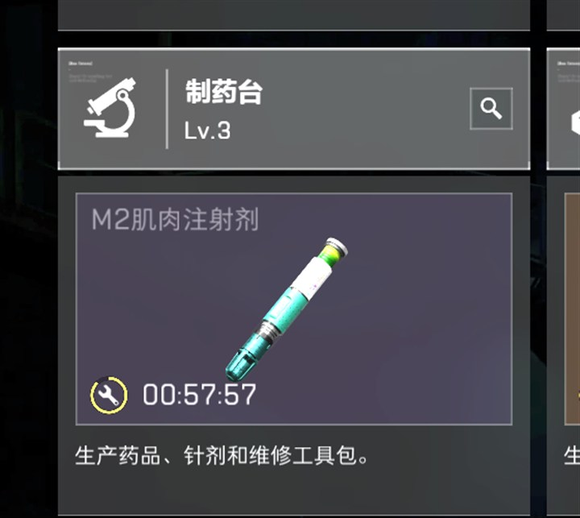
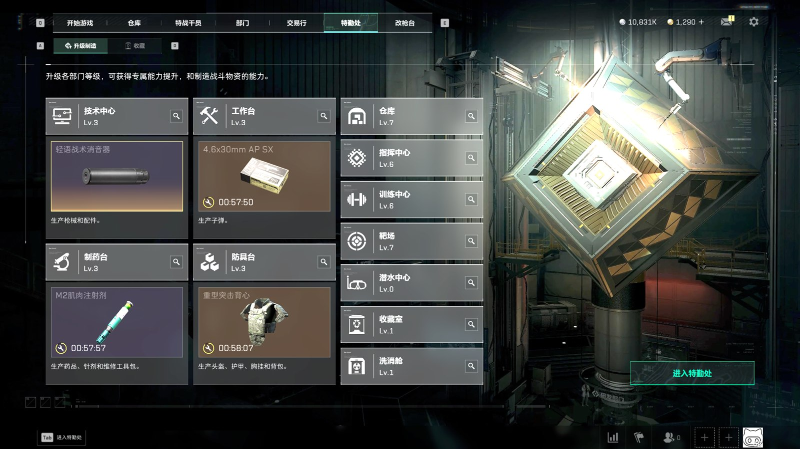
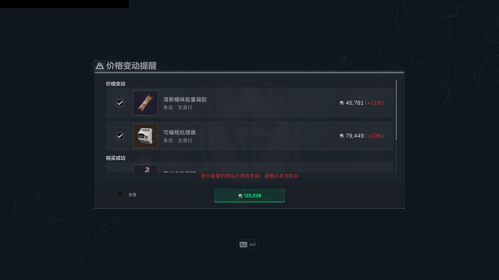

# DeltaCrafter-Fixed

[](#环境要求与运行方式)
[](#源码构建与测试)
[](#源码构建与测试)
[](LICENSE)

《三角洲行动》特勤处本地自动制造与调度助手的非官方社区修复维护分支，基于上游 [ixekico/DeltaCrafting](https://github.com/ixekico/DeltaCrafting) `v0.4.0`（固定基线提交 `04b19179fb629bf6803dde1b17fd8857ba516d45`）持续演进。

> 本仓库保留上游 MIT 许可证、版权声明与第三方组件声明。本项目**不是**游戏官方产品，也**不是**上游官方发布；所有识别与调度均在本地运行，不上传账号或截图数据。

---

## 快速导航

- [分支与版本状态](#分支与版本状态)
- [核心特性与深度优化](#核心特性与深度优化)
- [修复效果实拍](#修复效果实拍)
- [项目架构与目录结构](#项目架构与目录结构)
- [环境要求与运行方式](#环境要求与运行方式)
- [配置隔离与手动更新](#配置隔离与手动更新)
- [源码构建与测试](#源码构建与测试)
- [文档索引](#文档索引)
- [验证边界、安全与许可](#验证边界安全与许可)

---

## 分支与版本状态

| 渠道 | 版本 / 状态 | 说明 |
| --- | --- | --- |
| **GitHub Releases** | `v0.4.0-fix.1`（2026-10-24） | 首个预发布运行包，包含手电匹配键、长标题 ROI 扩展、全角点倒计时与数据目录隔离。 |
| **`main` 分支源码** | 持续更新（最新同步至 2026-11-27） | 在 `v0.4.0-fix.1` 基础上已完成多轮实机故障驱动的深度优化（812 项单元测试通过），尚未重新打包新的 Release ZIP；如需最新能力请按下方[源码构建](#源码构建与测试)本地编译发布。 |

---

## 核心特性与深度优化

### 1. 字符识别与倒计时解析
- **槽位名称清洗与双票高置信合并**：去空白后再修正实测中文同形误读（`喵准镜/描准镜/瞄准锯 → 瞄准镜`、`氵敫 → 激`），折叠框形/圈形零（`囗/〇/○ → 0`，保留汉字 `口`）、顿号小数点与 `PEQ一2 → PEQ-2` 连字符误读；剥离详情标题前的 `僉`/`※` 品质图标噪声；双票合并时优先保留独立标题共识、低噪声惩罚与高倍率（2x 优于 1x）读数。
- **倒计时全链路容错**：支持独立计时 ROI 形近字归一化（`J/a/A/O/口/〇 → 0`、`& → 7`、`℃ → :0`）与详情页「剩余时尚」标签容错；当严格 `HH:MM:SS` 与主候选归一化均失败时，复用同帧原图 2x 与备用读数（零额外 OCR）救回严格六位纯数字单分隔紧凑计时（`HHMM:SS` / `HH:MMSS`），44 张历史槽位故障原图实测识别率达 **123/124**（仅余 1 张真实空白槽位）。
- **配方目录规范化与升级保留**：内置 `Data/items.json`（rev 4）补齐 `.300 BLK TAC-TX`、`轻语战术消音器`、`PEQ-2红色激光镭指` 与 `OLIGHT WARRIOR 3S战术手电` 稳定匹配键；默认目录修订号升级时自动先备份 `.bak` 并合并保留玩家自扫描条目。

### 2. 同帧安全护栏与业务流程加固
- **特勤处同帧界面护栏**：每遍槽位观察及领取/开工点击槽位前，在**同一原始帧**复核「升级制造」探针且无断线弹窗遮挡，连续 2 遍离页立即中止，彻底避免画面切往仓库/社交/邮件后误判可领取并误点。
- **细分业务异常与防误点**：
  - 仓库满顶部 Toast 识别覆盖「仓库空间不足」「仓库已满」「仓库找不到可以容纳…的位置」及 OCR 单字漏读（`仓空间不足`/`库空间不足`）；
  - 补齐购买显式识别「商品已售罄，购买失败」与「前去兑换」材料弹窗，打开补齐清单后稳定等待 450ms 再点击总价按钮；
  - 自动识别低等级工位未解锁配方按钮（`等级3解锁` / `Lv.3解锁`），优雅退出并仅标单设施「需人工」，不中断其余工位；
  - 统一识别「一卜齐 / 一补齐 / 一健补齐」操作按钮误读；单槽位读数不确定时仅跳过该槽位，其余已确认工位正常领取与续造。
- **导航与启动链加固**：大厅顶栏支持逐词边界框定位「特勤处」（兼容相邻标签粘连及 `开始游观/游难` 误读）与过渡 3 帧重试；「赛季通行证进度」弹窗改用空格跳过；配方列表查找支持同帧 2x→1.5x 双倍率、首页 350ms 复读与触底有界向上回扫；WeGame 隐藏托盘窗口唤醒时先发 `SW_SHOW` + `SW_RESTORE` 并在隐藏态首次前台化失败时触发单实例唤起。

### 3. 智能调度与制造利润榜
- **随机收取窗口**：制造完成后在 `[执行缓冲, 执行缓冲 + 240 秒]`（默认 1–5 分钟）之间按“设施 + 完成分钟”FNV-1a 稳定推导随机领取时刻，既不卡点也不在 10 秒轮询中抖动。
- **无打扰策略**：仅在游戏完全退出时预启动，游戏运行中（含最小化到任务栏）不提前拉起窗口；遇未知界面（对局/社交/邮件页）最多按 1 次 ESC，仍未回到已知页面则自动暂停 2 小时。
- **每 3 小时公共利润行情**：接入只读国服制造利润榜（免 API Key，主备域名故障转移），支持四工位独立选择「自定义物品」「每小时利润最高」「总利润最高」；跨重启持久化行情快照，网络异常时保留最后有效行情与当前计划。

### 4. 性能、存储留存与界面体验
- **内存与轮询减负**：新增局部 ROI 裁剪二值化（`CropAndEnhanceContrast`）替代每遍多次 1440p 整帧大对象堆克隆；原始 2x/1x/1.5x 标题全票一致即短路跳过二值化；空闲断线监测改为单帧轻量化探测。
- **持久化并发安全**：`JsonStoreBrick` 采用固定 16 槽路径哈希分桶锁与唯一随机 `.tmp` 原子替换（失败自动清理）；`ScheduleEngine` 全路径读写加锁，`FacilitySnapshot()` 自动规范化历史遗留脏名显示。
- **诊断截图留存与界面可观测性**：内置 `ShotRetention` 按诊断组自动保留最近 14 天且不超过 80 组现场截图；设置页新增「诊断截图留存」卡片（异步统计占用体积 + 一键清理过期截图 + 打开目录）；总览页状态卡在上一轮成功时直接展示「上次执行」摘要与悬停全文提示。

---

## 修复效果实拍

### 槽位计时归一化：游戏显示 `00:57:57`，OCR 误读为 `0J58：09`





独立计时 ROI 只在常规严格解析失败时启用形近字归一化（`J→0`、`&→7`、`℃→:0`、分隔符统一）或严格六位单分隔回退，再交由严格分类器与双遍单调性校验。2026-11-26 实机日志亦证实 `4．6×3囗mmAPSX` 与 `视点3倍喵准镜` 均在两遍观察内（约 1.1 秒）准确规范为 `4.6×30mm AP SX` 与 `视点3倍瞄准镜`。

### 购买确认：覆盖完整绿色总金额按钮



“价格变动提醒”需要点击底部绿色总金额按钮（本帧 `125,230`）。扩大后的按钮 ROI 完整覆盖按钮区域，按 `1.5x → 1.0x → 2.0x` 读取并折叠已实测金额形近字，同时校验点击点位于 ROI 内且与当前帧窗口尺寸一致。

> 以上截图均取自本机真实运行画面，已遮挡账号 UID 与世界频道聊天，未做任何内容修饰。

---

## 项目架构与目录结构

依赖方向严格单向约束：**`UI (DeltaCrafter.App) → L3 → L2 → L1 → L0`**；核心层不引用 WinUI/WindowsAppSDK，保障全部流程逻辑与纯函数规则可独立单元测试。

```text
DeltaCrafter-Fixed/
├── src/
│   ├── DeltaCrafter.Core/         # 自动化核心（net8.0-windows10.0.19041.0）
│   │   ├── Data/                  # 内置默认模板：anchors.json (rev 10)、items.json (rev 4)
│   │   ├── L0/                    # 纯数据模型与不变量（TextMatch、CountdownParser、AnchorTable、ItemCatalog 等）
│   │   ├── L1/                    # 单一系统能力（OcrBrick、ScreenCaptureBrick、InputBrick、JsonStoreBrick、ShotRetention 等）
│   │   ├── L2/                    # 单业务流程（ScreenProbe、CollectFlow、CraftStartFlow、LaunchFlow、ScheduleEngine 等）
│   │   └── L3/                    # 跨流程总编排（AutomationCoordinator、ProfitPlanCoordinator、UpdateCoordinator）
│   └── DeltaCrafter.App/          # WinUI 3 Fluent 桌面端（unpackaged 自包含 win-x64）
│       ├── Pages/                 # 总览、制造计划、运行日志、设置页
│       ├── ViewModels/            # MVVM 状态模型
│       ├── Controls/ & Design/    # 卡片控件与 Fluent 设计令牌
│       └── Services/              # 组合根 AppHost、托盘、主题、通知与行情应用服务
├── tests/
│   └── DeltaCrafter.Core.Tests/   # xUnit 核心回归测试套件（812 项用例 + 脱敏样本 Fixtures）
├── scripts/
│   ├── build-release.ps1          # 锁定依赖还原、Release 构建、全量测试、自包含打包与 SHA-256 生成
│   └── Test-ReleasePrivacy.ps1    # 源码（Source）与发布包（Package）双模式隐私脱敏扫描
├── docs/                          # 构建与校准指南、验证记录与脱敏实拍图
└── licenses/                      # 第三方组件许可与声明
```

---

## 环境要求与运行方式

- **系统要求**：Windows 10 2004+ 或 Windows 11（x64），已安装**简体中文 OCR** 语言组件，需以**管理员权限**运行（与游戏同权限级别以保证 `SendInput` 不被 UIPI 拦截）。
- **显示建议**：游戏使用 **16:9 无边框窗口**；1920×1080 与 2560×1440 已覆盖坐标缩放测试与样本验证。

### 使用预发布包（`v0.4.0-fix.1`）

1. 从 [Releases](https://github.com/Shuang-Sec/DeltaCrafter-Fixed/releases) 下载 `DeltaCrafter-Fixed-win-x64-0.4.0-fix.1.zip` 与对应 `.sha256` 文件，核对 SHA-256 后**完整解压**到独立目录（不要只拷贝单个 exe），双击 `DeltaCrafter.Fixed.exe`。
2. 首次启动后到「设置」页指定游戏/启动器路径并确认窗口绑定。
3. 制造计划默认不启用、自动循环默认关闭；先点「识别当前任务」核对四工位识别准确，再按需开启自动循环。
4. 「材料不足时自动一键补齐」会消耗游戏内货币，不希望自动购买请在「制造计划」页关闭。
5. 图像识别与模拟输入依赖可见桌面；操作游戏前请先暂停或退出助手，避免人工操作与自动输入冲突。

---

## 配置隔离与手动更新

- **完全隔离**：修复版独立使用 `%LocalAppData%\DeltaCrafterFixed`，不读取原版 `%LocalAppData%\DeltaCrafter`；可执行文件名、单实例互斥键与开机自启计划任务名均已隔离。
- **禁自动覆盖**：停用启动自动更新检查与上游覆盖安装，避免被上游原版替换；设置页「更新说明」仅展示手动更新指引，不访问更新下载接口。
- **安全更新与回退**：退出运行中的助手，将新版自包含发布目录完整替换旧程序目录即可，本地数据目录 `%LocalAppData%\DeltaCrafterFixed` 原样保留；如需回退，退出助手后换回上一版本完整目录即可。

---

## 源码构建与测试

需安装符合 [global.json](global.json) 要求的 **.NET 8 SDK（8.0.4xx）** 与 **PowerShell 7（`pwsh`）**。

### 1. 日常编译与全量回归测试

```powershell
dotnet restore DeltaCrafter.sln --configfile nuget.config
dotnet build DeltaCrafter.sln -c Release -p:Platform=x64 --no-restore
dotnet test tests/DeltaCrafter.Core.Tests/DeltaCrafter.Core.Tests.csproj -c Release -p:Platform=x64 --no-build --no-restore
```

### 2. 一键生成自包含发布包（含隐私扫描与 SHA-256）

```powershell
pwsh -File scripts/build-release.ps1
```

脚本会执行源码隐私检查、锁定版本依赖还原、Release/x64 构建、全部 812 项单元测试、自包含 `win-x64` 发布（确定性编译、路径映射到 `/_/`、无 PDB）、发布包隐私检查，最终输出 ZIP 与 `.sha256` 到 `artifacts/`。

### 3. 提交与发布前隐私脱敏扫描

```powershell
pwsh -File scripts/Test-ReleasePrivacy.ps1 -Mode Source
pwsh -File scripts/Test-ReleasePrivacy.ps1 -Mode Package -Path artifacts/DeltaCrafter-Fixed-win-x64
```

脚本会检查构建主机用户标识、凭据特征、运行时配置（`settings.json`/`plan.json`/`state.json`）及调试符号（`.pdb`/`.log`）；脚本无法替代人工审查，提交与发布前请仍人工复核 `git diff` 与发布清单。

---

## 文档索引

| 文档 | 说明 |
| --- | --- |
| [CHANGELOG.md](CHANGELOG.md) | 完整变更日志（含 `Unreleased` 最新多轮优化与历史版本记录） |
| [docs/验证记录.md](docs/验证记录.md) | 单元测试、历史真图离线回放、实机冒烟与通宵运行验证记录 |
| [docs/构建与校准指南.md](docs/构建与校准指南.md) | 本地自包含打包、默认模板资源、ROI 标定与发布回退指南 |
| [CONTRIBUTING.md](CONTRIBUTING.md) | 架构分层约束、OCR 规则新增标准与 PR 提交规范 |
| [SECURITY.md](SECURITY.md) | 安全范围界定与漏洞私下报告指引 |
| [THIRD-PARTY-NOTICES.md](THIRD-PARTY-NOTICES.md) | 第三方依赖组件及许可证汇总 |

---

## 验证边界、安全与许可

- **验证边界**：公开测试套件（812 项）使用构造文本、默认模板与脱敏样本，不包含任何个人账号、原始日志或私密截图；虽然 `main` 分支核心能力已在 2560×1440 本机完成了通宵自动巡检冒烟（详见 [验证记录](docs/验证记录.md)），但仍不对所有分辨率/DPI 组合、游戏 UI 改版、第三方行情接口波动或游戏风控提供稳定性承诺。
- **代码签名提示**：本项目预发布包未进行商业代码签名，Windows 可能提示未知发布者；核对 SHA-256 仅用于校验文件完整性，不代表商业签名，请自行审查源码，不要关闭系统安全防护。
- **使用风险**：游戏自动化可能违反游戏服务条款或触发反作弊、封号及虚拟资产损失风险；本项目不提供绕过反作弊的功能，不承诺任何安全或收益，使用前请自行了解相关规则。
- **开源许可**：本项目源码沿用 [MIT License](LICENSE)，第三方许可详见 [THIRD-PARTY-NOTICES.md](THIRD-PARTY-NOTICES.md) 与 `licenses/`。
