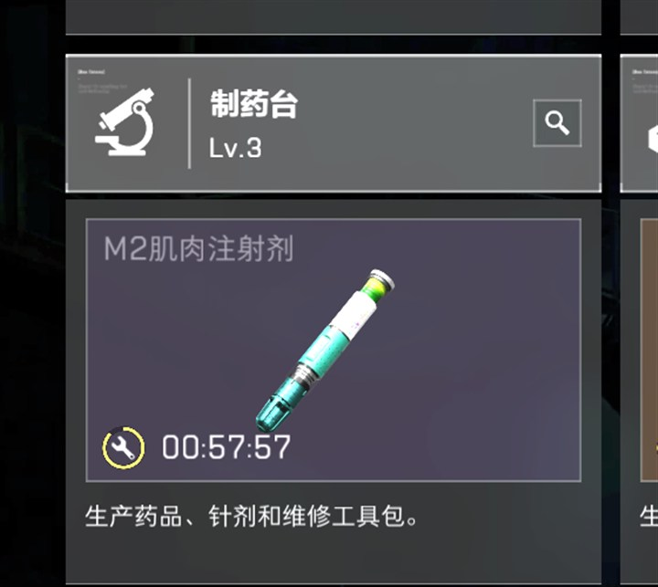
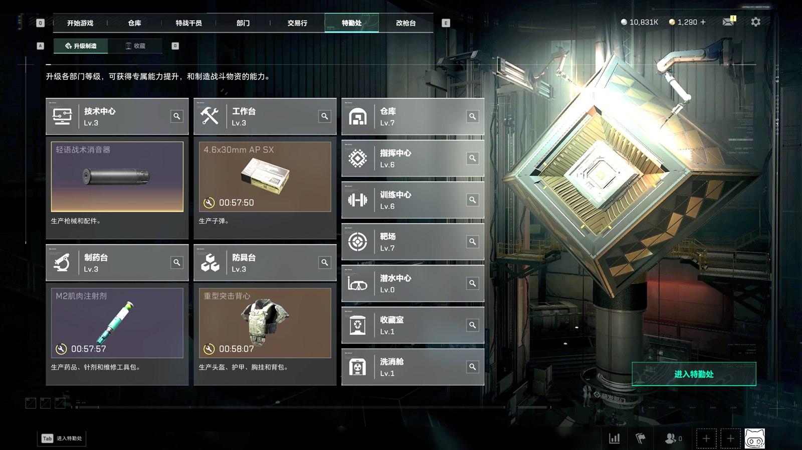
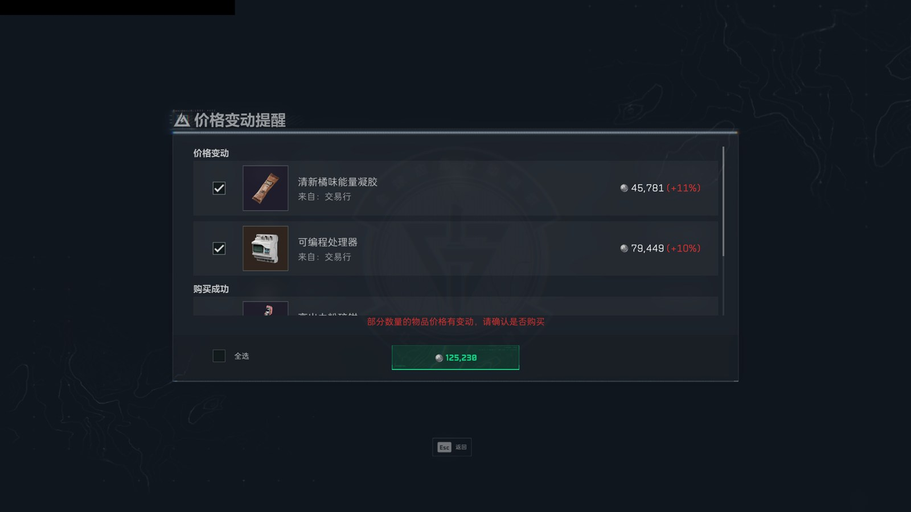

# 修复版验证记录

最后验证日期：2026-10-24。版本：`0.4.0-fix.1`（预发布）。

## 已完成

- 使用上游固定提交 `04b19179fb629bf6803dde1b17fd8857ba516d45` 建立无旧历史的独立源码工作副本。
- 按先写回归测试、再修复的顺序，初次定向测试出现 11 项预期失败；修复后全部 116 项测试通过，无跳过。
- 覆盖物品规范名、品牌 OCR 误读、真实列表选行函数的邻近型号拒绝、详情型号校验、1080p / 1440p 标题 ROI 缩放、全角点及非法倒计时、默认配置隔离。
- Release/x64 构建零警告、零错误；自包含 win-x64 发布，不分发调试符号。
- 在独立解压目录启动，确认主窗口显示修复版版本，中文 OCR 和默认资源加载成功。
- 首次初始化未导入游戏启动路径和精确窗口绑定；四个设施均未启用，自动循环关闭。
- 启动日志确认修复版自动更新被禁用；源码不再从应用更新服务调用上游下载/安装链路。
- NuGet 官方源直接与传递依赖漏洞查询未报告已知漏洞；这不等于对所有未知漏洞作出保证。
- 源码与展开运行目录执行当前构建用户标识、凭据特征、运行数据和 PDB 排除检查。发布说明不含个人现场资料。

## 未完成，不作承诺

- 尚未在全新 Windows 虚拟机上验证所有系统依赖组合。
- 尚未通过缺少中文 OCR 的真实系统验收，仅检查现有错误提示路径；未卸载任何系统语言组件。
- 本次没有为发布测试取消、补料或启动游戏内制造，也没有完成完整的“到期领取→续造”实机循环。
- 未覆盖所有 DPI、分辨率、窗口遮挡、锁屏、断线、弹窗、行情故障与游戏 UI 改版。

## 可重复验证

执行 `scripts/build-release.ps1` 进行锁定依赖还原、构建、单元测试、隐私扫描和 ZIP / SHA-256 生成。
公开测试数据为构造文本和内置默认资源，不包含真实截图、个人配置和运行日志。
隐私检查不能替代人工审查；上传前还需检查提交清单、提交身份与 Git 历史，上传后重新下载核对附件哈希。

## 2026-11-10 观察读数与购买确认修复（源码已同步，未发布构建）

### 现场截图

游戏里制药台显示 `00:57:57`，独立计时 ROI 却读成 `0J58：09`，五遍全部判 `Unknown`。

购买“价格变动提醒”需要点击底部绿色总金额按钮（本帧 `125,230`）；旧 ROI 会把首位数字截掉（读成 `、25，23B`）。
截图取自本机真实运行，已遮去账号 UID 与世界频道聊天。

### 根因

槽位的独立计时 ROI 会把 `00:58:09` 读成 `0J58：09`、把分隔符读成中点 `·` 或缺一个分隔符。
严格的倒计时解析因此失败，五遍观察全部判为 `Unknown`；旧的整轮逻辑在一个工位没有两票时就抛错，
已就绪的其它工位也不再领取。2026-11-10 16:39–16:40 的三次失败均属此类。

### 变更

- 新增 `SlotTimerCanonicalizer`：只在独立计时 ROI、且原读数解析失败时做形近字与分隔符归一化，
  输出必须还原成合法 `时:分:秒`；严格消费者与既有负例保持不变。
- 新增 `ObserveAllDetailedAsync` 与纯函数 `ResolveSlot`：未判定工位连同原因和末次读数返回，
  协调器先处理已确认工位，未判定工位保留上次运行态。
- 购买“价格变动提醒”金额按钮扩大 ROI 并容忍金额标签的已实测形近字；读取倍率顺序调整为 1.5x → 1.0x → 2.0x。

### 验证

- 完整单元测试 636 通过、0 失败、0 跳过；Release/x64 构建 0 警告、0 错误。
- 公开接口 682 项，新增 0、删除 0。
- 2026-11-10 16:40 真实失败帧回放：旧核心制药台/防具台 `Unknown 5/5`，新核心四工位全部有效判定。
- 部署后实机“识别当前任务”与两次定时轮均在两遍内取得四工位一致判定；
  日志出现 `计时区1归一化:0J16：26→0:16:26`、`计时区0归一化:07·30：41→7:30:41`。

### 未完成，不作承诺

- 未重新打包发布 ZIP/Release，版本号仍为 `0.4.0-fix.1`。
- 售罄与仓库满仍按超时处理，未改为明确的业务结论。
- 部分观察降级路径只有单元测试覆盖，实机尚未自然触发。
- 购买确认只在真实截图上回放通过，未在真实购买时点过确认。

## 2026-11-11 收取时间随机化（源码已同步，未发布构建）

### 需求

倒计时结束后 1–5 分钟的随机时刻再去特勤处领取，不要在完成前后就进去。

### 变更

- 制造中的下次执行时刻改为“完成时刻 + 随机收取延迟”，区间 `[执行缓冲, 执行缓冲 + 240 秒]`；
  延迟由“设施 + 完成时刻所在分钟”经 FNV-1a 稳定推导，10 秒一次的调度轮询不会抖动。
- 预启动游戏不早于最早一件制造的完成时刻。

### 验证

- 单元测试 641 通过、0 失败；公开接口 682 项不变。
- 同一完成时刻连续查询 10 次结果一致；24 个不同完成时刻覆盖 60–300 秒区间且不是固定值。
- 实机：部署后工作台完成时刻 18:11:32，日志“下次执行 18:14”，用部署的核心反算随机延迟 155 秒
  （18:14:07），与日志一致；旧逻辑为 18:12:32。

### 未验证

- 随机延迟的长期分布只做了单元抽样，未统计连续多轮的实际间隔。

## 2026-11-11 未知界面 ESC 恢复与计时读数补强（源码已同步，未发布构建）

### 需求

遇到没记录的界面（邮件、交易行通知等）先按几次 ESC 回到初始界面，再去特勤处领取。

### 变更

- 未知画面最多发送 1 次 ESC；按过仍认不出（对局里只会打开暂停菜单）时不再重复按键，自动执行暂停 2 小时。
- 计时 ROI 接受六位纯数字（`HHMMSS`）、`a/A→0`、ASCII 逗号分隔符；物品名与价格不经过该归一化。

### 验证

- 单元测试 647 通过、0 失败；公开接口 682 项不变。
- 实机：18:29 停在“邮件 → 交易行出售成功”页，第 1 次 ESC 后 2.7 秒到达大厅；
  `计时区3归一化:021438→2:14:38`、`计时区2归一化:0a2a35→0:20:35`，四工位全部判定，
  工作台随后被领取并重新开工。

### 未验证

- 对局内按 ESC 会打开暂停菜单，只做有限次尝试；没有统计对局中触发时的实际观感。

## 2026-11-11 预启动不再还原正在运行的游戏（源码已同步，未发布构建）

### 根因

预启动条件用“找不到游戏窗口”代表“游戏没开”；最小化窗口取不到 16:9 客户区几何，同样返回 null，
于是正在运行（最小化）的游戏被当成已关闭，在目标时刻前 120 秒被还原并抢到前台。

### 变更与验证

- 新增 `AutomationCoordinator.ShouldPrewarm`：游戏确实退出才预启动；运行中（含最小化）不碰窗口。
- 单元测试 650 通过；公开接口 682 项不变。实机 20:52:57 部署后同步通过，下次执行 01:47。
